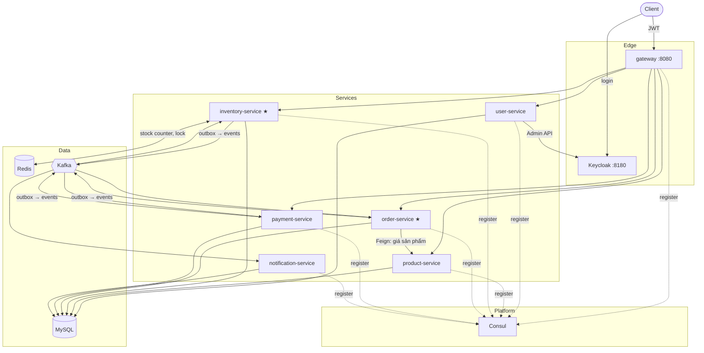
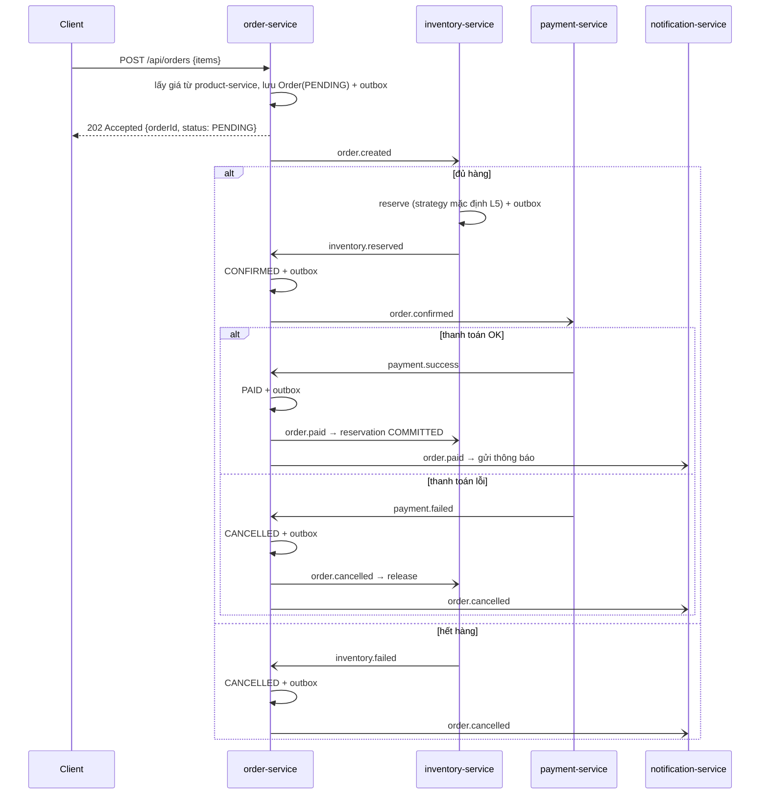

# 00 — Tổng quan: Shop Microservice System

Hệ thống thương mại điện tử theo kiến trúc microservice, phục vụ mục đích **học thuật**:

- **Event-driven / Saga choreography** qua Kafka với **Transactional Outbox + Inbox** (exactly-once về mặt nghiệp vụ trên nền at-least-once)
- **5 chiến lược chống oversell** cho tồn kho: DB conditional update, pessimistic lock, optimistic lock, distributed lock (Redisson), Redis atomic counter (Lua)
- **Keycloak** làm IdP: realm roles + client roles, realm-as-code
- **Redis** (standalone / Sentinel), **Kafka** KRaft (1 node / 3 node)
- **Observability** đủ 3 trụ: logs (ELK), metrics (Prometheus/Grafana), traces (OpenTelemetry → Elastic APM)
- **Scale ngang**: mọi service stateless, chạy N replica mà không đổi code/config

## 1. Lộ trình triển khai

| Giai đoạn | Môi trường | Cách chạy |
|---|---|---|
| **1. Local dev** | Laptop | Infra trong Docker Compose, app chạy từ IDE |
| **2. Local full** | Laptop | Toàn bộ (infra + apps) trong Docker Compose, thử `--scale` |
| **3. Server** | 1 server Linux | Cùng bộ compose, đổi `.env` + reverse proxy TLS |
| **4. Kubernetes** (sau) | k3s/kind → cluster | Chuyển compose → manifest/Helm (mapping trong [02-DEPLOYMENT](./02-DEPLOYMENT.md#7-chuyển-sang-kubernetes)) |

Cấu hình được thiết kế **12-factor ngay từ đầu** để bước 4 không phải viết lại app.

## 2. Tech stack

| Layer | Công nghệ | Ghi chú |
|---|---|---|
| Ngôn ngữ | Java 21 | Virtual threads |
| Framework | Spring Boot 3.2 / JHipster 8 | JHipster generate từ JDL |
| Gateway | JHipster Gateway (Spring Cloud Gateway, reactive) | Cửa vào duy nhất |
| Discovery | **Consul** | Thay JHipster Registry (deprecated). Lên K8s có thể tắt, dùng K8s DNS |
| Config | **Env var** (12-factor) | Không dùng Config Server/Consul KV |
| IdP | Keycloak 24 | Realm import từ JSON |
| Messaging | Kafka 3.7 (Confluent 7.7), KRaft | Không Zookeeper |
| Cache / lock | Redis 7.2 + Redisson (starter) | 1 client Redisson cho cả RedisTemplate và lock |
| DB | MySQL 8.0 | 1 instance, mỗi service 1 DB + 1 user |
| Migration | Liquibase | |
| Scheduler an toàn khi scale | ShedLock (JDBC) | Outbox relay, timeout, reconcile |
| Logs | JSON stdout → Filebeat → Logstash → Elasticsearch → Kibana | Không dùng TCP appender |
| Traces | Micrometer Tracing + OTel → OTLP → APM Server | Không dùng javaagent |
| Metrics | Micrometer → Prometheus (docker service discovery) → Grafana | |
| Build image | Jib (JHipster) | Không cần Dockerfile |

## 3. Services

| Service | Port | DB | Trách nhiệm |
|---|---|---|---|
| `gateway` | 8080 (public) | — | Routing qua Consul, OAuth2 login / bearer token, rate limit |
| `user-service` | 8081 | `db_user` | Profile người dùng (liên kết `sub` Keycloak), admin quản lý user qua Keycloak Admin API |
| `product-service` | 8082 | `db_product` | Sản phẩm, danh mục, **giá** (nguồn sự thật về giá) |
| `inventory-service` | 8083 | `db_inventory` | Tồn kho, reservation, **5 chiến lược lock** ★ |
| `order-service` | 8084 | `db_order` | Đơn hàng, state machine, saga ★ |
| `payment-service` | 8085 | `db_payment` | Thanh toán (mock, tỉ lệ thành công cấu hình được) |
| `notification-service` | 8086 | `db_notification` | Ghi nhận / gửi thông báo (mock) |

Chỉ `gateway` và `keycloak` được publish ra ngoài. Port của service nội bộ chỉ dùng khi chạy từ IDE.

## 4. Kiến trúc tổng thể

Giao tiếp đồng bộ **chỉ dùng để đọc dữ liệu** (order → product lấy giá). Mọi thay đổi trạng thái liên service đi qua Kafka.

## 5. Luồng đặt hàng (saga choreography)

Chi tiết topic, envelope, idempotency: [05-MESSAGING](./05-MESSAGING.md).

## 6. Quyết định kiến trúc chính

| # | Quyết định | Lý do |
|---|---|---|
| D1 | Config 100% qua env var, không hardcode `localhost` | Cùng image chạy được ở IDE / compose / server / K8s |
| D2 | Consul cho discovery, không Config Server | JHipster 8 mặc định Consul; config đi env giữ đường sang K8s đơn giản |
| D3 | Keycloak cùng URL trong và ngoài container (`http://keycloak:8180`) | Issuer JWT luôn khớp, không phải tách issuer/jwk-set |
| D4 | `userId` = Keycloak `sub` (String UUID) | Không cần đồng bộ ID số giữa Keycloak và DB |
| D5 | Outbox ở **mọi** service publish event, Inbox ở mọi consumer | Không dual-write; redelivery an toàn |
| D6 | Event là JSON string + envelope, không dùng type header của Spring | Producer/consumer không phụ thuộc class Java của nhau |
| D7 | Topic tạo bằng job `kafka-init`, key = `orderId` | 1 nguồn sự thật; không hot partition theo sản phẩm |
| D8 | Reservation là bảng riêng, unique `(order_id, product_id)` | Idempotency + release đúng đơn |
| D9 | Job định kỳ chạy qua ShedLock | Scale N replica không chạy trùng |
| D10 | Log stdout JSON, metric qua label, trace OTLP | Thêm replica không phải đổi cấu hình observability |
| D11 | Redis/Kafka mặc định 1 node, bản cluster là **lab** profile | 1 server không có HA thật; vẫn học được failover |

## 7. Tài liệu

| File | Nội dung |
|---|---|
| [01-ARCHITECTURE](./01-ARCHITECTURE.md) | JHipster + DDD, module `shop-common`, quy tắc stateless |
| [02-DEPLOYMENT](./02-DEPLOYMENT.md) | Compose, profiles, `.env`, chạy local / server, scale, đường lên K8s |
| [03-SECURITY](./03-SECURITY.md) | Keycloak realm-as-code, token, phân quyền, service-to-service |
| [04-INVENTORY](./04-INVENTORY.md) | Data model tồn kho, 5 chiến lược lock, Redis, benchmark |
| [05-MESSAGING](./05-MESSAGING.md) | Topic, envelope, outbox/inbox, DLT, consumer config |
| [06-USER-SERVICE](./06-USER-SERVICE.md) | user-service |
| [07-ORDER-SERVICE](./07-ORDER-SERVICE.md) | order-service, state machine, timeout; payment & notification |
| [08-OBSERVABILITY](./08-OBSERVABILITY.md) | Logs, metrics, traces, dashboard, alert |
| [09-IMPLEMENTATION-PLAN](./09-IMPLEMENTATION-PLAN.md) | Kế hoạch theo phase, Definition of Done |
