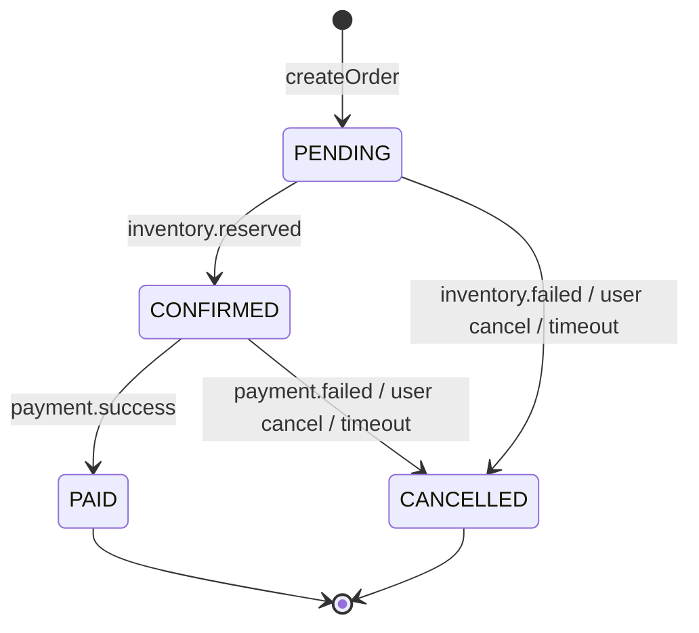

# 07 — order-service (+ product, payment, notification)

## 1. Aggregate `Order`

```sql
CREATE TABLE orders (
  id               VARCHAR(36)   PRIMARY KEY,       -- UUID sinh trong app (biết trước khi insert, không đoán được)
  user_id          VARCHAR(36)   NOT NULL,          -- Keycloak sub
  status           VARCHAR(16)   NOT NULL,
  total_amount     DECIMAL(19,2) NOT NULL,
  currency         CHAR(3)       NOT NULL DEFAULT 'VND',
  shipping_address VARCHAR(500),
  cancel_reason    VARCHAR(100),
  refund_required  BOOLEAN       NOT NULL DEFAULT FALSE,
  idempotency_key  VARCHAR(64),
  version          BIGINT        NOT NULL DEFAULT 0, -- 2 consumer cùng sửa 1 đơn → optimistic lock
  created_at       DATETIME(6)   NOT NULL,
  updated_at       DATETIME(6)   NOT NULL,
  confirmed_at     DATETIME(6),
  paid_at          DATETIME(6),
  cancelled_at     DATETIME(6),
  KEY idx_orders_user (user_id, created_at),
  KEY idx_orders_status_updated (status, updated_at),    -- job timeout
  UNIQUE KEY uk_orders_user_idem (user_id, idempotency_key)
);

CREATE TABLE order_item (
  id           BIGINT AUTO_INCREMENT PRIMARY KEY,
  order_id     VARCHAR(36)   NOT NULL,
  product_id   BIGINT        NOT NULL,
  sku          VARCHAR(50),
  product_name VARCHAR(200),
  unit_price   DECIMAL(19,2) NOT NULL,              -- snapshot giá lúc đặt, lấy từ product-service
  quantity     INT           NOT NULL,
  line_total   DECIMAL(19,2) NOT NULL,
  CONSTRAINT fk_item_order FOREIGN KEY (order_id) REFERENCES orders(id)
);
-- + outbox_event, processed_event, shedlock
```

## 2. State machine



Phạm vi dự án dừng ở `PAID`. Các trạng thái giao hàng và hoàn tiền (SHIPPING, DELIVERED, REFUNDING...) của v1 là ngoài phạm vi, sẽ làm sau nếu cần.

| Chuyển trạng thái | Event phát ra (outbox) |
|---|---|
| → PENDING | `order.created` |
| PENDING → CONFIRMED | `order.confirmed` |
| CONFIRMED → PAID | `order.paid` |
| → CANCELLED | `order.cancelled` (kèm `items`, để inventory release và tạo tombstone) |

Các method domain (`confirm()`, `markPaid()`, `cancel(reason)`) kiểm tra trạng thái nguồn và trả về **kết quả**. Chúng không throw cho những trường hợp có thể xảy ra trong hệ phân tán (mục 3).

## 3. Event đến muộn hoặc trùng

Trong saga, thứ tự event giữa các topic không được đảm bảo. Mọi tổ hợp dưới đây đều xử lý **thành công** (không throw, không vào DLT):

| Đơn đang ở | Nhận | Xử lý |
|---|---|---|
| CONFIRMED / PAID | `inventory.reserved` (trùng) | Bỏ qua (Inbox thường đã chặn trước) |
| CANCELLED | `inventory.reserved` | Bỏ qua. Inventory sẽ release khi xử lý `order.cancelled` (hoặc đã tạo tombstone) |
| CANCELLED | `payment.success` | Giữ CANCELLED, đặt `refund_required = true`, log ERROR + metric `order.refund.required`. Hoàn tiền ngoài phạm vi |
| PAID | `payment.failed` | Bỏ qua + log WARN |
| PENDING | `payment.*` | Không thể xảy ra trong luồng đúng. Log ERROR, bỏ qua |

Plan v1 throw `OrderStateException` ở những tình huống này. Kết quả là message bị retry 3 lần rồi vào DLT, trong khi dữ liệu không hề sai.

## 4. Tạo đơn

```
POST /api/orders
Idempotency-Key: <uuid do client sinh>         (tùy chọn, khuyến nghị)
{ "items": [{ "productId": 1, "quantity": 2 }], "shippingAddress": "Hà Nội" }
```

1. Validate: 1–20 item, quantity > 0, không trùng productId.
2. Nếu `(userId, Idempotency-Key)` đã tồn tại thì trả lại đơn cũ (client retry an toàn).
3. Lấy giá: Feign `ProductClient.getByIds(ids)` gọi qua Consul (`product-service`), timeout 2s, circuit breaker Resilience4j. **Server tự tính tổng.** Không nhận giá từ client như v1.
4. Một transaction: insert order + items + outbox `order.created`.
5. Trả `202 Accepted` `{ id, status: "PENDING" }`. Client poll `GET /api/orders/{id}` để theo dõi.

## 5. Job timeout (ShedLock)

```java
@Scheduled(fixedDelay = 60_000)
@SchedulerLock(name = "order-timeout", lockAtMostFor = "PT5M")
public void cancelExpired() {
    cancelOlderThan(PENDING,   props.pendingTimeout());     // mặc định 10 phút
    cancelOlderThan(CONFIRMED, props.paymentTimeout());     // mặc định 15 phút
}
```

Mỗi đơn hủy trong một transaction riêng (`cancel("TIMEOUT")` + outbox). Nếu consumer đồng thời sửa cùng đơn, `@Version` phát hiện xung đột; job sẽ thử lại ở lượt sau.

## 6. API

| Method | Path | Quyền |
|---|---|---|
| POST | `/api/orders` | `order:write` |
| GET | `/api/orders/{id}` | `order:read` + chủ đơn, hoặc ADMIN |
| GET | `/api/orders?page=` | `order:read` (chỉ đơn của mình) |
| POST | `/api/orders/{id}/cancel` | chủ đơn (khi PENDING/CONFIRMED) |
| GET | `/api/admin/orders?status=&page=` | ADMIN |

## 7. Metrics

`order.created`, `order.confirmed`, `order.paid`, `order.cancelled{reason}` (counter), `order.refund.required` (counter), `order.saga.duration` (timer từ PENDING tới PAID/CANCELLED, tag `outcome`).

---

## 8. product-service

- CRUD `product`, `category`. **Nguồn sự thật về giá.**
- `GET /api/products/{id}`, `GET /api/products?ids=1,2,3` (cho order-service). Public, không cần token.
- `POST/PUT` cần `product:write`.
- Có thể cache đọc bằng Caffeine TTL ngắn (30s), vì giá stale vài giây là chấp nhận được và order chụp snapshot giá tại thời điểm đặt.
- Tạo sản phẩm **không** tự tạo tồn kho. Admin nhập kho qua `POST /api/inventory/{productId}/adjustments`, giữ hai service độc lập.
- Seed data: Liquibase `context="dev"`, 10 sản phẩm.

## 9. payment-service (mock)

- Consume `order.confirmed` → tạo `payment` (unique `order_id` → idempotent) → mock: thành công với xác suất `PAYMENT_MOCK_SUCCESS_RATE`, delay ngẫu nhiên 100–500 ms.
- Phát `payment.success` / `payment.failed` qua outbox.
- `GET /api/admin/payments?orderId=` (ADMIN).

```sql
CREATE TABLE payment (
  id         VARCHAR(36)   PRIMARY KEY,
  order_id   VARCHAR(36)   NOT NULL UNIQUE,
  amount     DECIMAL(19,2) NOT NULL,
  currency   CHAR(3)       NOT NULL,
  status     VARCHAR(16)   NOT NULL,   -- SUCCEEDED | FAILED
  reason     VARCHAR(100),
  created_at DATETIME(6)   NOT NULL
);
```

## 10. notification-service (mock)

- Consume `order.paid`, `order.cancelled` (Inbox) → ghi `notification_log` → "gửi" (log INFO).
- Không publish event, nên không cần outbox.
- Muốn gửi email thật: thêm Mailpit vào profile `tools` và cấu hình `spring.mail.*` qua env.
