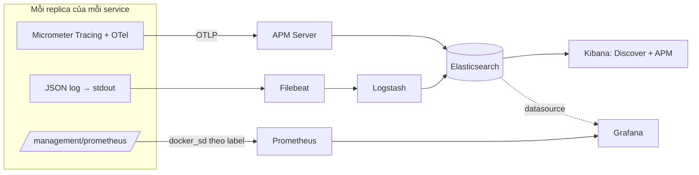

# 08 — Observability: Logs, Metrics, Traces

Config hạ tầng nằm trong `deploy/observability/` (profile `observability`).



**Nguyên tắc:** app không biết địa chỉ của Logstash hay Prometheus. App chỉ ghi stdout, expose endpoint và gửi OTLP tới một URL lấy từ env. Thêm hay bớt replica không làm thay đổi cấu hình nào ở phía observability.

## 1. Logs

### App

JHipster đã có sẵn JSON logging (LogstashEncoder). Bật bằng env (đã đặt trong `deploy/apps/compose.yaml`):

```
JHIPSTER_LOGGING_USE_JSON_FORMAT=true
```

Khi chạy từ IDE thì để `false` để log dạng text cho dễ đọc. **Không** cần `logback-spring.xml` riêng hay `LogstashTcpSocketAppender` như v1.

Micrometer Tracing tự đưa `traceId`, `spanId` vào MDC, và encoder ghi chúng thành field JSON. Từ một dòng log trong Kibana có thể nhảy thẳng sang trace tương ứng.

Quy ước log:
- Ghi id nghiệp vụ dạng key=value trong message: `orderId=…`, `productId=…`, `strategy=L5`.
- Không log token, password hay toàn bộ request body.
- ERROR chỉ dành cho lỗi cần người can thiệp. Hết hàng là WARN/INFO.

### Pipeline

| Bước | File | Ghi chú |
|---|---|---|
| Filebeat | `filebeat/filebeat.yml` | Chỉ thu container có label `co.elastic.logs/enabled=true` (apps gắn sẵn) |
| Logstash | `logstash/pipeline/logstash.conf` | Parse JSON, thêm `service` (tên compose service), `instance` (tên container) |
| Index | `shop-logs-YYYY.MM.dd` | Một index mỗi ngày cho mọi service; lọc bằng field `service` |

### Kibana

1. Stack Management → Data Views → tạo `shop-logs-*`, time field `@timestamp`.
2. Index Lifecycle Policy: xóa sau 7 ngày (local) / 14 ngày (server).

Query mẫu (KQL):

```
service : "inventory-service" and level : "ERROR"
message : "orderId=c1f6*"
traceId : "4bf92f3577b34da6a3ce929d0e0e4736"
service : "order-service" and message : "refund_required"
```

## 2. Traces (OpenTelemetry)

### Dependencies (mỗi service)

```xml
<dependency>
  <groupId>io.micrometer</groupId>
  <artifactId>micrometer-tracing-bridge-otel</artifactId>
</dependency>
<dependency>
  <groupId>io.opentelemetry</groupId>
  <artifactId>opentelemetry-exporter-otlp</artifactId>
</dependency>
```

Bỏ javaagent Elastic APM của v1. Cũng bỏ cấu hình Zipkin v1 để thừa: cấu hình đó trùng chức năng và không có Zipkin server nào nhận.

### Cấu hình (env, đã có trong compose)

| Env | Giá trị |
|---|---|
| `MANAGEMENT_OTLP_TRACING_ENDPOINT` | `http://apm-server:8200/v1/traces` (IDE: `http://localhost:8200/v1/traces`) |
| `MANAGEMENT_TRACING_SAMPLING_PROBABILITY` | `1.0` dev, `0.1` server |

### Trace xuyên service

| Chặng | Cơ chế |
|---|---|
| HTTP (gateway → service, Feign) | Tự động (W3C `traceparent`) |
| Kafka gửi trực tiếp | `spring.kafka.template.observation-enabled=true` |
| Kafka nhận | `spring.kafka.listener.observation-enabled=true` |
| Qua outbox | Lưu `trace_parent` lúc ghi, relay khôi phục (05-MESSAGING §8) |

Xem trace: Kibana → Observability → APM → Services. Mỗi service tự hiện với tên `spring.application.name`.

## 3. Metrics

### Hợp đồng label (thay cho static target của v1)

Prometheus đọc Docker API và scrape mọi container có:

```yaml
labels:
  prometheus.io/scrape: "true"
  prometheus.io/port: "8083"
  prometheus.io/path: /management/prometheus     # mặc định /metrics
```

Label `service` = tên compose service, `instance` = tên container. Scale lên 3 replica thì Prometheus thấy 3 target cùng `service`. Đây là cùng mô hình với annotation `prometheus.io/*` trên Kubernetes.

App chạy từ IDE: bật `prometheus/targets/dev-host.yml` (02-DEPLOYMENT §4.3).

### Metric chuẩn (có sẵn)

| Nguồn | Ví dụ |
|---|---|
| Spring Boot / Micrometer | `http_server_requests_seconds_*`, `jvm_*`, `hikaricp_connections_*`, `kafka_consumer_*`, `spring_kafka_listener_*` |
| kafka-exporter | `kafka_consumergroup_lag`, `kafka_topic_partition_current_offset` |
| redis-exporter | `redis_connected_clients`, `redis_memory_used_bytes`, `redis_commands_processed_total` |
| Keycloak | `/metrics` |
| node-exporter | CPU, RAM, disk của server |

Bật histogram cho HTTP để tính được P99 (`application.yml`):

```yaml
management:
  metrics:
    distribution:
      percentiles-histogram:
        http.server.requests: true
    tags:
      application: ${spring.application.name}
```

### Metric nghiệp vụ

| Metric | Loại | Tag | Service |
|---|---|---|---|
| `inventory.reserve` | Timer | `strategy`, `outcome` | inventory |
| `inventory.stock.drift` | Gauge | — | inventory |
| `outbox.pending.events` | Gauge | — | mọi service có outbox |
| `outbox.oldest.pending.age.seconds` | Gauge | — | mọi service có outbox |
| `order.created`, `order.paid`, `order.cancelled` | Counter | `reason` (cancelled) | order |
| `order.refund.required` | Counter | — | order |
| `order.saga.duration` | Timer | `outcome` | order |

Quy tắc chung:
- **Không** dùng tag có cardinality không giới hạn (`product_id`, `order_id`, `user_id`).
- Các metric cùng tên phải có cùng bộ tag key.
- Đăng ký meter một lần (hoặc dùng `MeterRegistry` builder rồi `.register()` ngay trong lúc ghi). Không tự tạo `Gauge` lặp lại trong vòng lặp như `KafkaLagMetrics` của v1; lag đã có sẵn từ kafka-exporter.

### Alert

`prometheus/alerts/shop-alerts.yml`: TargetDown, HighErrorRate, HighLatencyP99, KafkaConsumerLagHigh, OutboxBacklog, DeadLetterReceived, InventoryReserveFailureHigh.

Hiện chưa có Alertmanager nên alert chỉ xem được tại `http://localhost:9090/alerts`. Khi lên server, thêm Alertmanager + Telegram/Slack.

## 4. Grafana

Datasource được provision sẵn: `Prometheus` (mặc định) và `Logs` (Elasticsearch `shop-logs-*`).

Dashboard nên import (Dashboards → Import → ID), rồi export JSON vào `deploy/observability/grafana/dashboards/` để lưu vào repo:

| Dashboard | ID |
|---|---|
| JVM (Micrometer) | 4701 |
| Spring Boot 3.x Statistics | 19004 |
| Kafka Exporter Overview | 7589 |
| Redis Exporter | 763 |
| Node Exporter Full | 1860 |

Dashboard tự làm, tên **Shop Business**:

| Panel | PromQL |
|---|---|
| Đơn tạo / phút | `sum(rate(order_created_total[1m])) * 60` |
| Tỉ lệ đơn thành công | `sum(rate(order_paid_total[5m])) / sum(rate(order_created_total[5m]))` |
| Reserve theo strategy (RPS) | `sum by (strategy) (rate(inventory_reserve_seconds_count{outcome="success"}[1m]))` |
| Reserve P99 theo strategy | `histogram_quantile(0.99, sum by (le, strategy) (rate(inventory_reserve_seconds_bucket[1m])))` |
| Reserve thất bại theo lý do | `sum by (outcome) (rate(inventory_reserve_seconds_count{outcome!="success"}[1m]))` |
| Outbox tồn | `max by (service) (outbox_pending_events)` |
| Consumer lag | `sum by (consumergroup, topic) (kafka_consumergroup_lag)` |
| Hikari chờ connection | `max by (service) (hikaricp_connections_pending)` |

## 5. Health

| Endpoint | Dùng cho |
|---|---|
| `/management/health/liveness` | Restart container khi treo (K8s `livenessProbe`) |
| `/management/health/readiness` | Healthcheck compose / K8s `readinessProbe`: chỉ nhận traffic khi DB, Kafka... sẵn sàng |
| `/management/health` | Xem chi tiết (cần quyền) |

Đã bật bằng `MANAGEMENT_ENDPOINT_HEALTH_PROBES_ENABLED=true`. Readiness **không** nên phụ thuộc vào service khác (vd product-service), nếu không một service chết sẽ kéo cả chuỗi chết theo.
